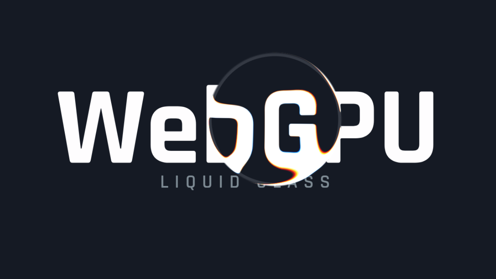

# Liquid Glass in WebGPU 💎

### 🔗 **YouTube Video](https://youtu.be/lq-ikfNVx7g)**

[](https://youtu.be/lq-ikfNVx7g)

This is a small piece of glass, shaped like a pill, that floats over a web page. Drag it over the text and the words underneath bend, like they would under a real magnifying lens. A thin rainbow shows at its edge, and its rim shines, the way Apple's Liquid Glass design looks.

Everything you see on the glass comes from one small program that runs on your graphics card. The video builds that program step by step:

### 🔗 **https://youtu.be/lq-ikfNVx7g**

## Words used here

- **WebGPU**: the way a web page talks to your graphics card. It is newer than WebGL and runs in recent Chrome, Edge and Safari.
- **Shader**: a small program that runs on the graphics card. It works out the colour of every pixel at the same time, which is why it is fast.
- **Signed distance**: for any point, how far it is from the edge of a shape. The number is negative inside the shape and positive outside, so one number tells you both where the point is and how close to the edge.
- **Fresnel**: glass reflects more light when you look at it from the side than when you look straight at it. That is why the rim of a glass looks brighter than its middle.

## Run it

You need Node.js and a browser that supports WebGPU. In a terminal, inside this folder:

```bash
npm install
npm run dev
```

The first line downloads the few libraries the project uses. The second starts a local web server and prints an address. Open that address in your browser and drag the glass.

## How it works

The glass is drawn on its own canvas, sitting on top of the page. Each frame, it needs to know what the page looks like under it, so it can bend that picture. Here is each file, in the order the picture flows:

- `src/capturePage.ts` takes a picture of the page once, when it loads and when the window changes size, and sends it to the graphics card. A shader cannot read a web page directly, only pictures, so this step is needed. It uses the html2canvas-pro library to take the picture.
- `src/main.ts` places the glass on the big headline and lets you drag it. Every frame it tells the shader where the glass sits on the page, so the shader reads the right part of the picture.
- `src/glassUniforms.ts` holds the numbers that set the glass's size and look, such as how strongly it bends and how wide the rainbow is. They are the same numbers the video uses.
- `src/GlassRenderer.ts` sets up WebGPU and runs the shader on the glass canvas every frame.
- `src/glassPassShader.ts` is the glass itself, and the file to read first. It is the exact shader from the video, line for line. For each pixel it finds the signed distance to the pill's edge, uses it to bend the page like a lens, splits red, green and blue apart near the edge for the rainbow, and adds Fresnel and a bright rim.

## Credits

This project uses other people's work. Thank you to:

- Inigo Quilez, for the rounded box signed distance: https://iquilezles.org/articles/distfunctions2d/
- Christophe Schlick, for the Fresnel approximation, from "An Inexpensive BRDF Model for Physically-based Rendering" (1994)
- yorickshan, for html2canvas-pro, which takes the page picture: https://github.com/yorickshan/html2canvas-pro
- Apple, for Liquid Glass, the design this project re-creates: https://developer.apple.com/design/

## License

MIT. You can use, change and share this code, including in paid work, as long as you keep the copyright notice. The full text is in [LICENSE](./LICENSE).
